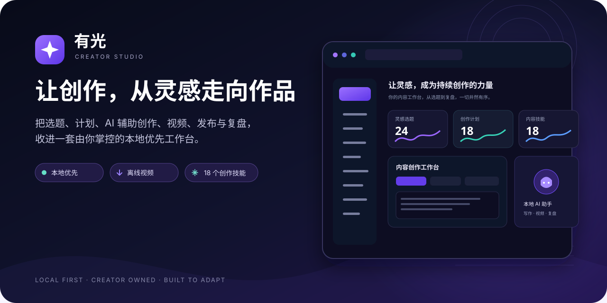
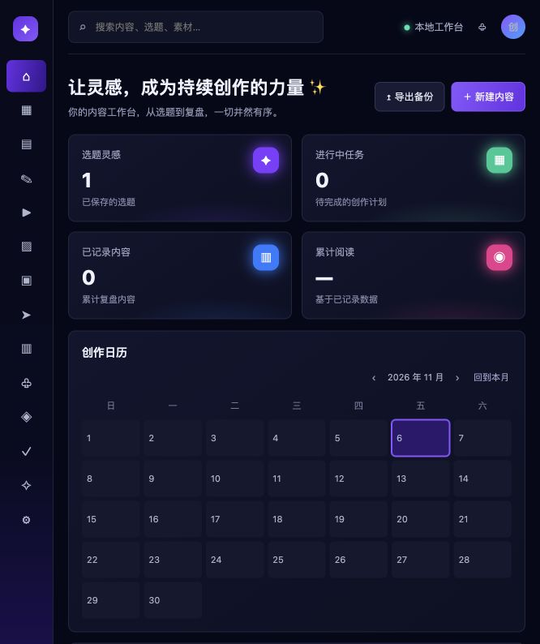
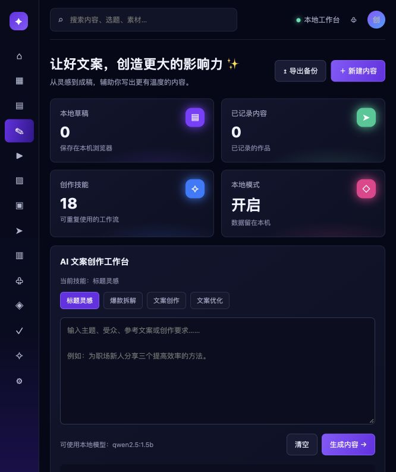
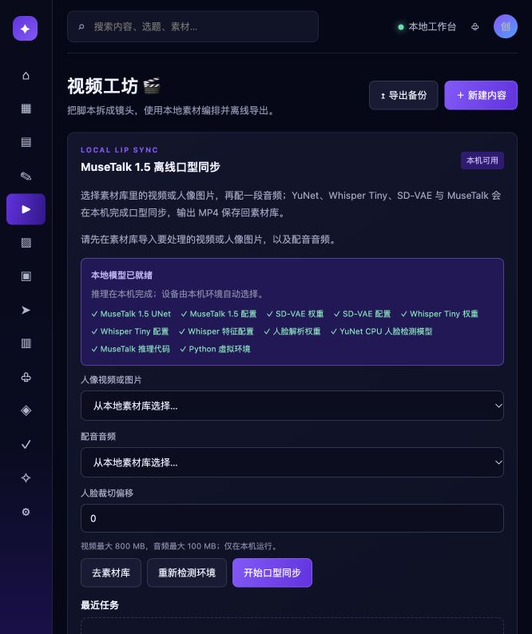

<div align="center">



### 把灵感、创作、发布与复盘，放进一套自己的工作流

**有光**是一款本地优先的自媒体创作工作台。它把选题、计划、AI 辅助写作、素材、封面、离线视频、发布管理和数据复盘连接起来，让创作者少在工具之间来回切换，把时间留给内容本身。

[功能总览](#功能总览) · [产品优势](#产品优势) · [快速开始](#快速开始) · [隐私与产品边界](#隐私与产品边界)


</div>

## 产品预览

### 一个工作台，串起创作全流程



### AI 辅助创作与可复用技能



### 本机视频工坊与 MuseTalk 离线口型同步



## 功能总览

| 模块 | 你可以做什么 | 带来的好处 |
| --- | --- | --- |
| 选题中心 | 手动沉淀灵感；按需获取 B 站公开热门和 V2EX 热门；将选题转成计划 | 灵感有来源、有状态，后续能接着做 |
| 内容策划 | 用月历安排选题、任务和发布时间；导出日历文件 | 提前看清内容节奏，减少临时赶稿 |
| AI 创作与技能库 | 使用 18 个内置技能完成标题、爆款结构拆解、短视频脚本、小红书笔记、直播话术、评论回复和复盘等任务；可添加自己的技能 | 把常用方法沉淀成可重复的工作流，生成内容仍由创作者判断和打磨 |
| 素材库 | 在本机浏览器中整理图片、音频、视频、文档、文字与链接 | 素材和内容记录放在一起，查找更直接 |
| 封面设计 | 使用 4 种本地模板；调整画幅、字体、配色、背景和遮罩；导出 PNG；可接入本地 ComfyUI 生图 | 快速做出适合不同平台的封面，并保存版本表现 |
| 离线视频工坊 | 将脚本拆成可编辑镜头；设置时长、字幕、运镜、转场、配乐和画幅；本地渲染 WebM 或导出 SRT | 小型短视频制作流程留在桌面端，素材不必上传到云端 |
| MuseTalk 口型同步 | 接入本机 MuseTalk 1.5、SD-VAE、Whisper Tiny 和 YuNet，为视频或人像图片配音并生成 MP4 | 在本地完成数字人口型任务；模型权重单独安装，不塞进仓库 |
| 发布管理 | 维护发布计划和素材；按需连接本机 `sau` 发布工具 | 账号、平台和发布时间集中管理；实际发布仍由你检查并确认 |
| 数据与复盘 | 手动记录、CSV 导入和分析作品表现；同步 B 站公开作品数据、粉丝数和投稿数；把结果整理成下一步行动 | 用实际表现迭代选题与表达，逐步积累自己的经验 |
| 粉丝运营与商业记录 | 管理评论、私信草稿、合作和变现记录；导入导出 CSV | 让互动和合作信息有迹可循，不依赖零散表格 |
| 备份与主题 | ZIP/JSON/CSV 备份与迁移；6 套强调色主题 | 工作成果可以带走，界面也能按习惯调整 |
| 任务恢复与维护 | 恢复可恢复的本地生成任务；提供环境诊断；macOS 可选安装休眠唤醒看守程序 | 遇到临时中断时更容易继续工作，固定端口冲突时不会误杀其他程序 |

## 产品优势

**围绕创作者的真实流程设计。** 从选题、排期、创作、素材、封面和视频，到发布记录、作品数据和复盘，模块之间可以继续传递内容，减少复制粘贴和重复录入。

**本地优先，数据由你掌控。** 选题、创作计划、草稿与素材记录保存在本机浏览器。可选连接本地 Ollama、ComfyUI 和 MuseTalk；未安装本地大模型时，内置模板会明确作为模板使用，不冒充 AI 推理结果。

**让 AI 做辅助，不替你做主。** 标题、结构和初稿都可以编辑、复制或保存。发布操作需要你检查平台账号、内容和素材后主动执行；工作台不会擅自替你发布或发送评论、私信。

**能按自己的方法继续扩展。** 创作技能可以新增和调整；模型与本地服务可按机器环境接入；数据支持备份、迁移和表格导出。核心工作流、界面实现和本地集成由本项目开发；整体视觉方向参考用户提供的公开案例，具体参考与实现边界见 [参考图分析](参考图分析.md)。模型和基础依赖沿用对应上游项目。


## 快速开始

需要 Node.js 22.12 或更新版本。本项目当前主要在 macOS 桌面环境开发和测试；核心前端基于 Node.js 与现代浏览器，Windows/Linux 的自动启动和本地模型安装脚本尚未验证。进入本仓库目录后运行：

```bash
npm ci
npm run dev
```

默认在 <http://127.0.0.1:5194/> 打开工作台。开发端口固定为 5194；若它已被其他应用占用，启动会报错而不会偷偷切换端口。需要改端口时，先检查系统监听和你自己的端口登记表，再把 `CREATOR_PORT` 设为已经确认可用的固定端口。

常用检查：

```bash
npm test
npm run build
npm run doctor
```

核心选题、计划、素材管理、技能模板和视频编辑无需账号。联网热点、B 站公开数据和第三方平台发布需要网络及各自的登录环境。

### 可选：连接本地 AI 与视频模型

- **Ollama**：在设置页填写本机已安装并准备好的模型名称；也可以运行 `setup-local-ai.sh` 安装本地运行环境。模型本身不包含在仓库中。
- **ComfyUI**：在本机运行 ComfyUI 并准备相应模型后，可用于本地文案辅助或封面背景生成。具体模型和工作流由本机配置决定。
- **MuseTalk 1.5**：安装 `ffmpeg`，准备 MuseTalk、SD-VAE、Whisper Tiny、人脸解析和 YuNet 权重，然后运行 `setup-musetalk.sh`。权重从各自上游来源获取，不随仓库下载；首次安装需要网络，安装完成后可离线推理。

本机模型下载量较大，首次推理速度取决于模型、硬件和内存。MuseTalk 支持本机 CPU/MPS/CUDA 环境自动选择，实际速度以运行设备为准。

macOS 用户可按需运行 `./install-autostart-macos.sh` 安装登录与休眠唤醒后的本机看守程序；运行 `./uninstall-autostart-macos.sh` 可移除。看守程序只检查本工作台登记的 5194 端口，不会关闭占用该端口的其他应用。

## 隐私与产品边界

- 核心资料保存在浏览器本地存储；清理浏览器数据前请先导出备份。换浏览器或在 `localhost` 与 `127.0.0.1` 之间切换，会使用不同的浏览器存储空间。
- 发布计划只是管理工具，不会在指定时间自动替你发帖。第三方平台是否支持定时发布，以该平台和本机发布工具的实际能力为准。
- B 站同步仅读取公开作品和公开账号数据。其他平台后台数据、评论和私信不会自动抓取；评论、私信草稿需手动或通过 CSV 导入，也不会自动发送。
- 热点获取、公开数据同步和第三方发布需要联网。配置云端模型时，发给模型服务的内容会按该服务的条款处理；需要本地使用时请配置本地模型。
- 视频工坊的本地渲染依赖现代浏览器的 `MediaRecorder` 与 Canvas 捕获能力；浏览器不同，编码格式和音频导出支持可能不同。
- 平台登录、账号状态和上传结果应以对应平台页面为准。平台接口或登录机制变更时，相关连接器可能需要更新。

## 开源与上游组件

本项目独立开发创作工作流、界面和本地集成。Vite、fflate、MuseTalk、YuNet 以及 Ollama/ComfyUI 等工具由各自上游维护。仓库不包含模型权重、运行时缓存或用户素材；使用和再分发各组件、代码与模型前，请查阅对应项目及模型的最新许可证。详见 [第三方组件说明](THIRD-PARTY-NOTICES.md)。

## 开发质量

项目使用原生 JavaScript 模块与 Vite，业务数据默认不依赖云端数据库。自动检查覆盖选题、CSV、发布流程、离线视频、主题、模型运行状态和本地存储等模块。提交前运行 `npm test` 与 `npm run build`。

如果遇到安全问题，请参考 [SECURITY.md](SECURITY.md) 中的报告方式。
